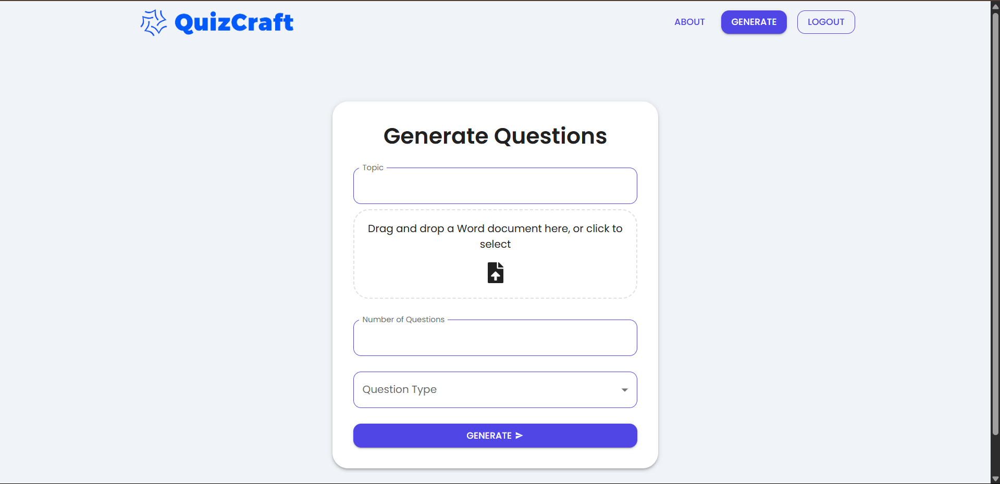

# QuizCraft

## Introduction

With QuizCraft, I explored how to build a practice quiz around a specific passage in someone’s study notes. You choose a topic and upload a Word document. The prototype finds relevant passages and prepares a prompt for the model.

## Tech stack

React and Expo provide web and mobile clients. Express and MongoDB handle accounts. The FastAPI generation service uses python-docx, Sentence Transformers, FAISS and Microsoft Phi-3.5 Mini Instruct.

## Features

- Upload a `.docx` and choose a topic, question count and format.
- Request multiple-choice, true/false, short-answer or fill-in-the-blank questions.
- Retrieve document passages and fall back to selected reference sites when the initial search misses its threshold.

## The process

1. The FastAPI handler reads the document paragraphs with python-docx and groups the text into chunks.
2. The service embeds each chunk with `all-MiniLM-L6-v2`, stores it in a FAISS index and searches for passages close to the topic.
3. If the initial search misses its distance threshold, the fallback checks its local topic cache and can search Wikipedia, Britannica or the Stanford Encyclopedia of Philosophy. It adds the retrieved material to the index and searches again.
4. The service passes the retrieved context, topic, question format and count to Microsoft's `Phi-3.5-mini-instruct`.

## How it can be improved

I’d give each document its own index and increase the output limit so the model can finish a question. My first test would use two unrelated documents and trace each question back to the passage that prompted it.

### Current behavior

- **Inputs.** Supply both the topic and a Word document. The API requires both even though the web form labels the topic optional.
- **Output length.** The model configuration sets `max_new_tokens` to 1. Increase it in `Flask/app.py` to generate a complete question set.
- **Document scope.** The FAISS index persists across requests within one process. Use a single local session and sample documents when exploring retrieval.

## How to run

| Component | Entry point |
| --- | --- |
| Web client | From `Mern/frontend/`, run `npm ci` and `npm start`. |
| Account service | From `Mern/backend/`, configure `MONGO_URI` and `JWT_SECRET` for development, run `npm ci`, then `node server.js`. The default port is 5000. |
| Generation service | From `Flask/`, serve `app:app` with `uvicorn app:app --port 8000`. Despite the directory name, this service uses FastAPI. |
| Mobile client | `NativeApp/` contains the Expo client and its quiz and results screens. |

The Python service needs a CUDA-capable environment for its configured model placement, model downloads, and dependencies for FastAPI multipart uploads, Transformers, PyTorch, Accelerate, Sentence Transformers, FAISS, python-docx, Scrapy and Google search. The repository does not include a pinned Python environment.

## Screenshots

